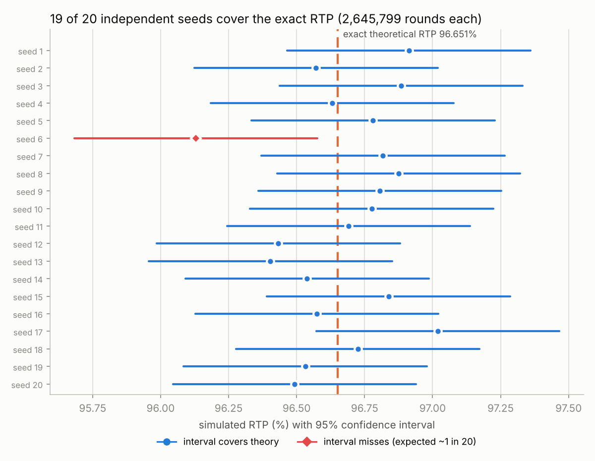
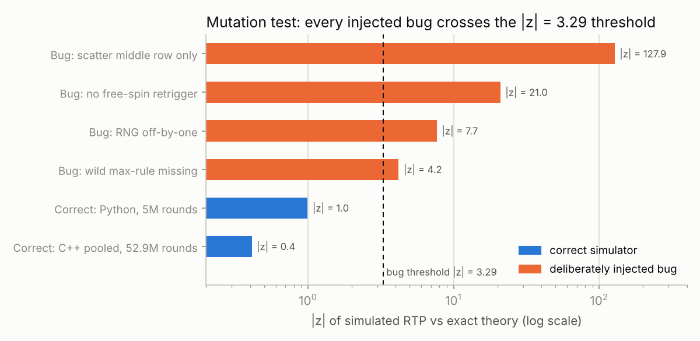
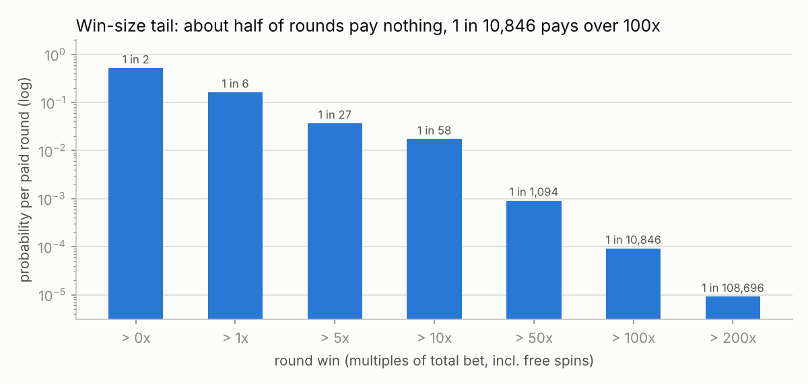

# Jade Dragon — 老虎機機率模型與可重現模擬驗證工具

A synthetic 5×3 slot (fictional, built from scratch for this portfolio, no proprietary data) with an exact RTP model,
two independent simulators (Python + C++), confidence-interval-based acceptance and a regression pipeline.

> 自行設計的合成題目，不含任何公司的模型、數值表或原始碼。作者：侯銘輝（[@Benny021018](https://github.com/Benny021018)）

## 給審閱者：5 分鐘導覽

| 想看什麼 | 去哪裡 |
|---|---|
| 規則、理論 RTP、模擬方法、次數、結果、差異分析 | 下面的「一頁摘要」 |
| 完整驗收報告（11 項檢查、分布與極端值、突變測試） | [`reports/v1.0.0/report.md`](reports/v1.0.0/report.md) |
| AI 工具與工作流案例 | [`docs/AI_WORKFLOW.md`](docs/AI_WORKFLOW.md) |
| 理論 RTP 怎麼算 | [`slotmath/theory.py`](slotmath/theory.py) |
| 獨立 C++ 實作（窮舉、蒙地卡羅、逐盤面評估） | [`cpp/slot.cpp`](cpp/slot.cpp) |
| 驗收流程與統計判定 | [`validate.py`](validate.py)、[`slotmath/stats.py`](slotmath/stats.py) |
| 規格與參數（唯一來源） | [`config/game_v1.yaml`](config/game_v1.yaml) |
| 回歸測試 | [`tests/test_regression.py`](tests/test_regression.py) |

## 一頁摘要

| 項目 | 內容 |
|---|---|
| 規則 | 5 軸 × 3 列、20 固定線，總押注 = 20 × 線注。Wild 替代 Scatter 以外的所有符號，本身也有賠率，線獎取「Wild 連線賠率」和「替代後符號賠率」中較大者。Scatter 任意位置 3/4/5 個賠 2/10/100 倍總押注；3 個以上觸發 10 次免費遊戲，獎金 ×2，可再觸發 +10 次 |
| 理論 RTP | **96.6506%**（精確分數 3223228345 / 3334927869）：主遊戲線獎 61.79%、主遊戲 Scatter 4.99%、免費遊戲 29.87% |
| 其他理論值 | 命中率 51.82%、觸發機率 1/54.7、每次觸發期望 12.24 次免費遊戲、每局回報標準差 σ = 3.71 倍押注 |
| 理論方法 | 解析計數（有理數運算）＋ C++ 窮舉全部 13,798,512 種停輪組合，兩者精確相等；免費遊戲用更新方程式／分支過程算期望值與變異數 |
| 模擬方法 | Python（numpy PCG64）與 C++（自行實作 xoshiro256** + Lemire 無偏取整）兩套獨立實作，固定亂數種子 |
| 執行次數 | 依 σ 規劃：要求 ±0.10% 精度、95% 信心 → 52,915,975 局；分成 20 個種子各 2,645,799 局；另跑 Python 500 萬局 |
| 統計結果 | C++ 合併 RTP 96.672%，95% CI [96.572%, 96.772%]，z = +0.41；20 個種子中 19 個的 CI 涵蓋理論值；z 值標準差 0.94 |
| 差異分析 | 理論值落在所有合併 CI 內；命中率、觸發率、免費遊戲次數、σ 都和理論一致；4 種刻意植入的 bug 全部被抓出（見報告第 7 節） |

完整報告：[`reports/v1.0.0/report.md`](reports/v1.0.0/report.md) · 所有數字：[`reports/v1.0.0/results.json`](reports/v1.0.0/results.json)

## 結果一覽

**模擬與理論一致**：20 個獨立種子各跑 2,645,799 局，19 個的 95% 信賴區間涵蓋精確理論值，符合「約 20 次有 1 次沒涵蓋」的預期。



**驗收流程抓得到 bug**：刻意植入 4 種常見錯誤，|z| 全部超過門檻；正確的模擬器則遠低於門檻。



**波動與極端值**：約一半的局沒有獎金，超過 100 倍的大獎約 1/10,846。



圖表由 `python tools/make_figures.py reports/v1.0.0/results.json docs/figures` 從驗收結果產生。

## 驗證設計

```
規格 config/game_v1.yaml（版本號 + SHA-256）
   │
   ├─ ① 解析理論  slotmath/theory.py     有理數精確值
   ├─ ② 窮舉      cpp/slot.cpp enum      全部停輪組合，獨立程式碼
   │      └─ ①＝② 精確相等？ → 精確命中率、精確 σ
   ├─ ③ 逐盤面比對 Python vs C++（20 萬組隨機盤面必須 100% 相同）
   ├─ ④ 樣本量    n = (z·σ / E)²
   ├─ ⑤ 蒙地卡羅  Python 1 個種子 + C++ 20 個種子 → CI、z 檢定、CI 涵蓋率
   ├─ ⑥ 卡方檢定  停輪位置是否均勻（檢查 RNG 和抽樣）
   ├─ ⑦ 突變測試  植入已知 bug，確認流程抓得到
   └─ ⑧ 波動分析  獎金分布、極端值、玩家 200 局的資金曲線
```

為什麼不用「誤差 < 0.5%」這種固定門檻：容許誤差應該由 σ 和 n 決定。高波動遊戲跑 1,000 萬局也可能單純因為運氣差超過 0.5%；低波動遊戲就算有 bug，也可能在 0.5% 內過關。

## 執行

```bash
pip install -r requirements.txt          # numpy, scipy, pyyaml, pytest
python validate.py config/game_v1.yaml   # 約 75 秒，產出 reports/v<版本>/
pytest -q                                # 16 項回歸測試（golden values、跨實作比對、規則單元測試）
```

修改參數的流程：改 YAML → 更新 `model_version` → `python validate.py` → 檢查報告 → 確認後更新 golden values → commit。

## 檔案結構

| 路徑 | 用途 |
|---|---|
| `config/game_v1.yaml` | 規則、賠率表、線型、輪帶（唯一的參數來源） |
| `tools/make_strips.py` | 用固定種子產生輪帶（限制 S 在輪帶上至少間隔 3 格） |
| `tools/make_figures.py` | 從 `results.json` 產生 README 圖表 |
| `slotmath/model.py` | 載入與檢查設定、參考用線獎函式、匯出給 C++ 的規格檔 |
| `slotmath/theory.py` | 解析理論 RTP 與拆分 |
| `slotmath/sim.py` | 向量化蒙地卡羅模擬器 |
| `slotmath/stats.py` | CI、樣本量、z 檢定、卡方、Wilson 區間 |
| `slotmath/mutants.py` | 刻意植入 bug 的模擬器 |
| `cpp/slot.cpp` | 獨立實作：窮舉 / 蒙地卡羅 / 逐盤面評估 |
| `validate.py`, `report.py` | 驗證流程與報告產生 |
| `tests/` | pytest 回歸測試 |
| `docs/AI_WORKFLOW.md` | AI 工作流案例 |
